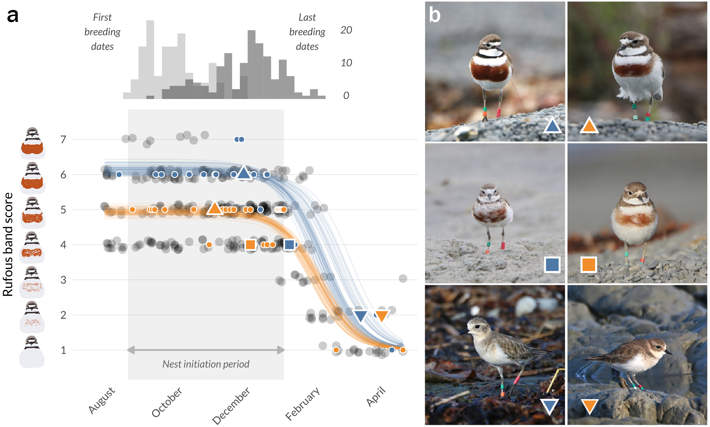

# Reproducible companion repository for:

## Age class and late reproductive activity predict delayed post-breeding ornamental molt in a partially migratory shorebird

### Luke Eberhart-Hertel, Bashar Jarayseh, Ailsa McGilvary-Howard, Ted Howard, Tony Habraken, Colin F. J. O'Donnell, Emma M. Williams, and Bart Kempenaers

This repository is the manuscript companion for the banded dotterel molt study.
Its main purpose is to let readers render a single Quarto document that
reproduces the analyses, figures, and reported statistics presented in the
manuscript, plus the small set of supporting analyses referenced in the text and
supplementary materials.

For correspondence about the repository, contact Luke Eberhart-Hertel:
`luke.eberhart@bi.mpg.de`

## What the repository reproduces

The main document is [`banded_dotterel_moult.qmd`](banded_dotterel_moult.qmd),
with a rendered companion HTML file at
[`banded_dotterel_moult.html`](banded_dotterel_moult.html).

The Quarto document reproduces:

- manuscript Figure 1a via the tracked static photo montage in `figs/combined_figure_draft.png`
- manuscript Figure 1b from the photo-level molt and breeding data
- manuscript Figure 2 (non-linear model schematic)
- manuscript Table 1
- manuscript Figure 3 (state-dependent molt trajectories)
- manuscript Figure 4 (breeding-phenology effects)
- supplementary Figure S1 (raw sampling distributions)
- supplementary Figure S2 (exploratory sibling comparison)
- supporting checks referenced in the manuscript text, including age-class differences in breeding phenology and Fisher exact tests for sex composition across age class and migratory status

The Quarto file renders from the saved model objects in `out/`, so readers do
not need to refit the Bayesian models to reproduce the reported results. Model
fitting chunks are retained in the source as `eval=FALSE` blocks for full
transparency and optional refitting.

## Repository contents

- [`banded_dotterel_moult.qmd`](banded_dotterel_moult.qmd): source document for the full reproducible workflow
- [`banded_dotterel_moult.html`](banded_dotterel_moult.html): rendered HTML companion
- [`data/moult_breeding_KK_data.rds`](data/moult_breeding_KK_data.rds): main photo-level molt and breeding dataset
- [`data/breeding_KK_data.rds`](data/breeding_KK_data.rds): bird-season breeding phenology dataset
- [`data/nests_KK_data.rds`](data/nests_KK_data.rds): nest dataset used for the breeding-period overlay in Figure 1b
- `out/`: saved `brms` model objects used to reproduce the manuscript tables and figures without refitting
- [`figs/combined_figure_draft.png`](figs/combined_figure_draft.png): static manuscript panel used for Figure 1a
- [`figs/fig2.png`](figs/fig2.png): overview image displayed in this README

## Rendering the document

1. Open the repository root in RStudio or render from the command line.
2. Install the R packages checked at the top of `banded_dotterel_moult.qmd`.
3. Render `banded_dotterel_moult.qmd`.

The document is configured so that normal rendering uses the saved model objects
already included in the repository. A working `cmdstanr` plus CmdStan
installation is only needed if you want to rerun the time-consuming model
fitting chunks.

## Notes on scope

This repository is intentionally trimmed to the files needed for the manuscript
companion itself. Older exploratory outputs, alternative figure variants, and
auxiliary model objects not referenced in the manuscript have been excluded from
the tracked subset.
